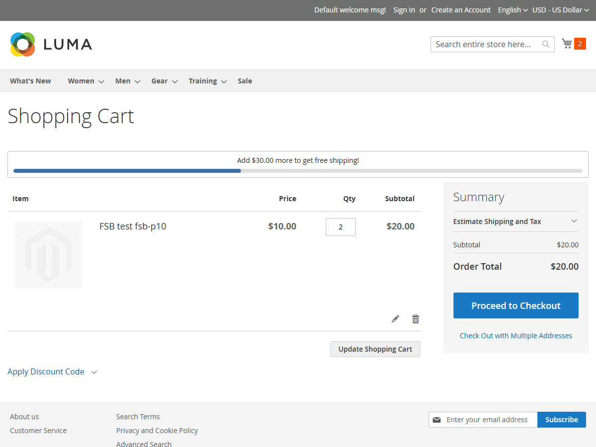
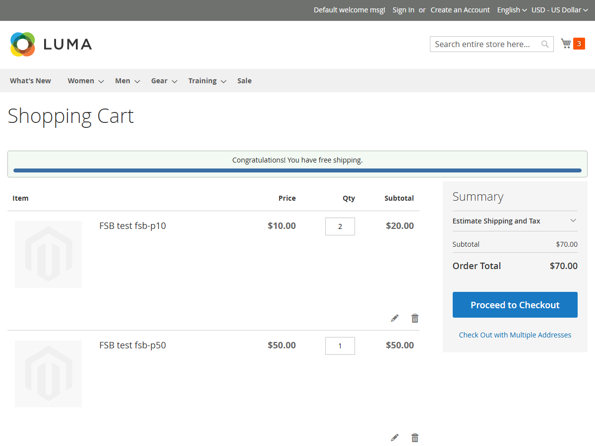
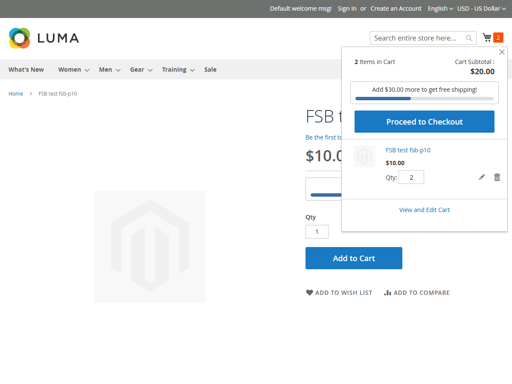
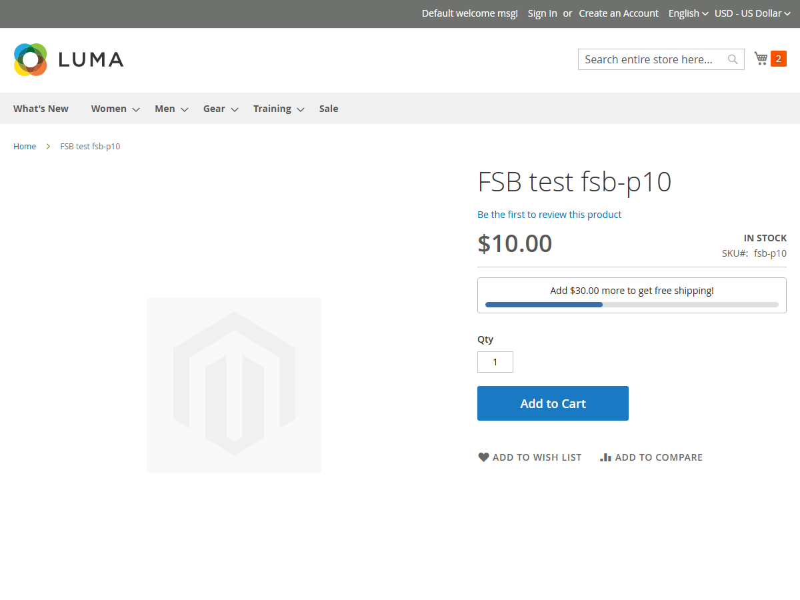
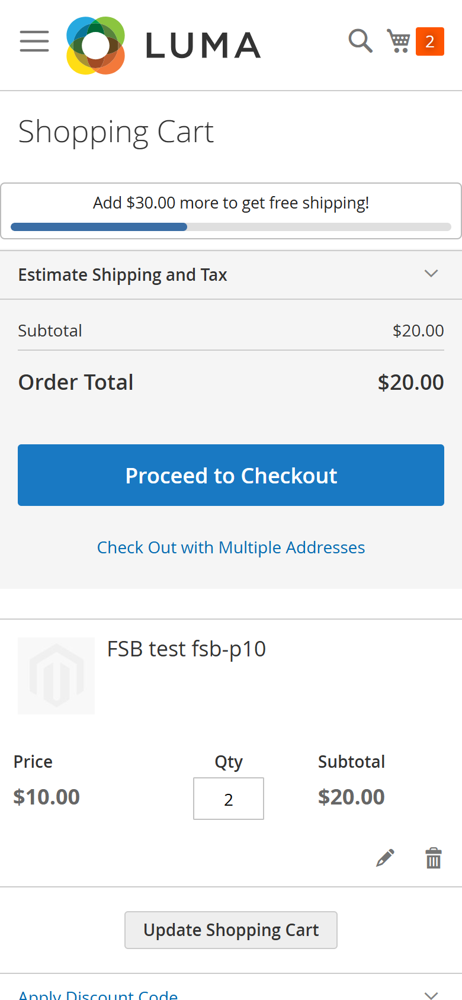
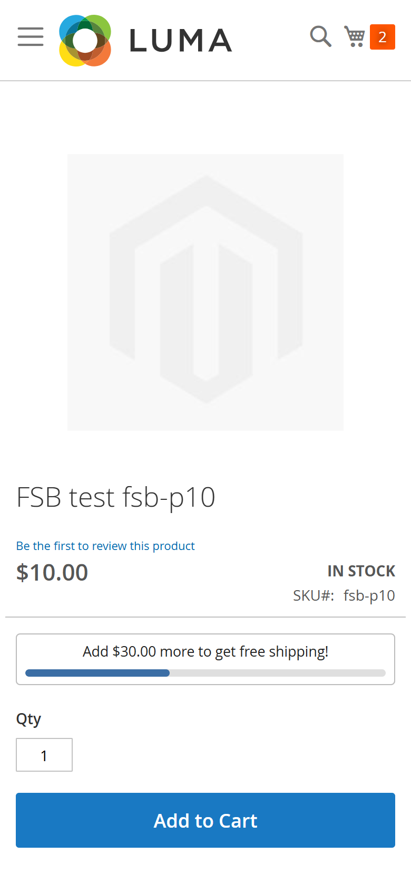
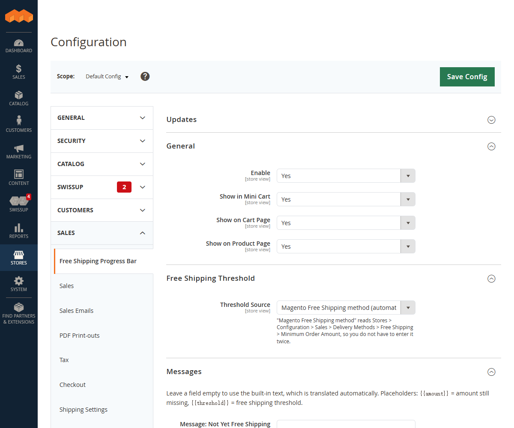

# Free Shipping Progress Bar for Magento 2

Show customers how close they are to **free shipping** — in the mini cart, on the cart page and on product pages.

> "Add $12.50 more to get free shipping!" + a progress bar. Free, open source (MIT).

**More features: see [GetDropFlow](https://getdropflow.com) (getdropflow.com).**
If this module is useful to you, please give the repository a star ⭐ — it helps others find it.

## Features
- Reads the threshold from Magento's own **Free Shipping** method (Minimum Order Amount) — no need to enter it twice. Or override it in the module settings.
- Mini cart, cart page and product page, each can be switched off separately.
- Updates instantly when the cart changes, no page reload.
- Works with Full Page Cache and Varnish (data is loaded in the browser).
- Multi-currency and multi-store-view aware; texts are translated (English, Spanish, Chinese included) and can be overridden per store view.
- Read-only: never touches orders, payments, prices or shipping calculation. No tracking.
- Download edition: authorize the store once with a free GetDropFlow account (see below).

## Screenshots

| Cart page | Free shipping reached |
|---|---|
|  |  |

| Mini cart | Product page |
|---|---|
|  |  |

| Mobile (cart) | Mobile (product page) |
|---|---|
|  |  |

Settings (Stores > Configuration > Sales > Free Shipping Progress Bar):



## Download
- **Main download: the [Releases page of this repository](https://github.com/jinguoren11/free-shipping-bar-magento/releases)** — every version has a zip attached (`getdropflow-module-free-shipping-bar-<version>-direct.zip`). This edition has one-click upgrade.
- Adobe Commerce Marketplace edition: install with Composer (updates come from Adobe).

## Install (first time, manual)
1. Download the zip from Releases and unzip it into your Magento folder `app/code/GetDropFlow/` (you get `app/code/GetDropFlow/FreeShippingBar/`).
2. Run:
```
bin/magento module:enable GetDropFlow_FreeShippingBar
bin/magento setup:upgrade
bin/magento setup:di:compile
bin/magento setup:static-content:deploy -f
bin/magento cache:flush
```

### Upgrading
- **Download edition**: Stores > Configuration > Sales > Free Shipping Progress Bar > press **Check for updates**, then one click. It backs up the old version, upgrades, and puts everything back automatically if anything goes wrong.
  It reads the public latest-release information of this GitHub repository (result cached), only when you press the button; it sends no store data. *(One-click upgrade is being finished; until it is released, upgrade by repeating the manual install with the new zip.)*
- **Marketplace edition**: updates come through Adobe Commerce; the module never downloads code by itself.

## Authorize your store (download edition, version 1.1.0 and later)
The bar is free, but the download edition must be linked once to a **free GetDropFlow account**: Stores > Configuration > Sales > Free Shipping Progress Bar > press **Log in to GetDropFlow to authorize**, log in on the page that opens, check the code and press **Allow**. No key to copy. Until then the bar is not shown to customers; the cart, checkout and orders are never touched.
- An authorized store keeps working for 30 days when the GetDropFlow website cannot be reached; only the website's clear "store removed / revoked" answer locks it at once.
- If a paid plan ended, a blue note is shown and the free bar keeps working.
- **Privacy:** only the web address of your store and the e-mail of the account you log in with are shared; the store keeps its own token (not your account key). A cron job asks the license server (license.getdropflow.com) every 6 hours; the storefront never contacts it.
- The Adobe Commerce Marketplace edition needs no authorization and never contacts any website.
- Step-by-step guide with screenshots: [English](docs/user-guide/AUTHORIZATION.en.md) · [中文](docs/user-guide/AUTHORIZATION.zh.md) · [Español](docs/user-guide/AUTHORIZATION.es.md).

## Configure
Stores > Configuration > Sales > **Free Shipping Progress Bar**.
For the automatic threshold, enable Stores > Configuration > Sales > Delivery Methods > **Free Shipping** and set a Minimum Order Amount.

## Supported themes
| Your theme | What to install | Status |
|---|---|---|
| Magento **Luma**, **Blank**, and themes built on them (most themes) | This module only | Tested: mini cart, cart page, product page |
| **Hyvä** (including the CSP build) | This module **and** the Hyvä compatibility package `getdropflow-module-free-shipping-bar-hyva-<version>-direct.zip` (same Releases page, unzip it into `app/code/GetDropFlow/`) | Tested: cart page, product page, cart drawer |
| **Breeze** (Swissup) | This module only (built in) | Tested: mini cart, cart page, product page |
| Other Luma-based themes | This module only | Usually work; if the bar does not appear, set a **custom position** (see `docs/THEMES.md`) |
| Headless storefronts (PWA Studio, Next.js, Vue Storefront, React) | Not supported | The module renders inside the Magento storefront |

Without the Hyvä compatibility package the bar does not appear on a Hyvä store (no error is shown). Details, the CSP note and the custom-position steps: [`docs/THEMES.md`](docs/THEMES.md).

## Compatibility
Magento Open Source / Adobe Commerce 2.4.x, PHP 8.1+.

## Tests
Unit tests need only PHPUnit 10 (no Magento): `FSB_AUTOLOAD=/path/to/vendor/autoload.php phpunit`.

## License
MIT. Made by [GetDropFlow](https://getdropflow.com).
